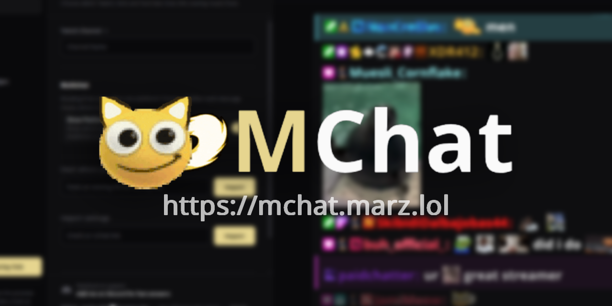

# MChat

### One chat overlay for Twitch, Kick, YouTube Live, and TikTok LIVE.

**Free · Customizable · No account needed**

[Try it now](https://mchat.marz.lol/) · [Report a bug](https://github.com/MarzzzDev/marz-overlay/issues) · [About & credits](https://faq.marz.lol)

---

MChat brings messages from your live chats into one clean, configurable browser overlay. Set it up in the browser, preview the look, then add the generated link to OBS or another app that supports browser sources.

## ✨ Features

- 🎮 **Four platforms:** Twitch, Kick, YouTube Live, and TikTok LIVE
- 😀 **Emotes:** platform emotes plus 7TV, BetterTTV (BTTV), and FrankerFaceZ (FFZ), where supported
- 🏅 **Badges:** platform badges and community badge sources including Chatterino and Homies
- 🎨 **Make it yours:** fonts, colors, shadows, strokes, message cards, spacing, and layout controls
- 🪄 **Chat behavior:** animations, fading, timestamps, filters, highlights, and emote effects
- 🖼️ **Extra display options:** Twitch GIFs, profile pictures, platform indicators, and more
- 👀 **Live preview:** see your changes before putting the overlay in your stream
- 🔗 **Portable settings:** generated links, `.mc` import/export, and compatible ChatIS/UChat link import
- 🔄 **Recovery helpers:** platform reconnect/retry logic and moderator refresh commands

> Feature availability depends on the platform and its services. MChat displays chat; it does not send messages or replace platform moderation tools.

## 🚀 Quick start

1. Open **[mchat.marz.lol](https://mchat.marz.lol/)**.
2. Enter the channel name or stream link for each platform you want to show.
3. Adjust the appearance and behavior in the setup page preview.
4. Copy the generated overlay URL.
5. In OBS, add a **Browser** source, paste the URL, and set the source size to fit your scene.

That’s it—no account or Twitch login is needed for normal setup. The same browser-source URL workflow works in other streaming software with browser sources.

### YouTube tip

Enter a channel handle to find its current live stream, or paste a live/video URL or 11-character video ID to connect directly.

## 🧩 Platform notes

| Platform | What MChat can display |
| --- | --- |
| 🟣 Twitch | Chat, Twitch emotes and badges, channel GIFs, and supported chat events |
| 🟢 Kick | Chat, Kick emotes and badges, and supported third-party emotes |
| 🔴 YouTube Live | Live chat, custom emoji, badges, and supported membership, Super Chat, and moderation events |
| ⚫ TikTok LIVE | Chat, supported events, TikTok emotes/media, and badges |

TikTok connections use MChat’s separate events service. Platform and third-party data availability can affect which messages, emotes, or badges appear.

## 🛠️ Settings & migration

Overlay links include your selected channels and settings. Reopen a generated link in the setup page to continue editing it. You can also export/import settings as `.mc` files or import compatible **ChatIS** and **UChat** overlay links.

## 🔄 Reliability

MChat includes reconnect handling for Twitch and Kick, retries for YouTube chat, and backoff for TikTok event polling. Moderator commands can reconnect platform connections or refresh the overlay. The overlay also checks for repository updates and can refresh when a new version is detected.

These features help recover from interruptions; they cannot guarantee uninterrupted service. Platform access, the TikTok event service, and external emote/badge providers can affect availability.

## 🧑‍💻 Self-hosting

MChat is a static browser app. Serve this repository over HTTP(S), then open `index.html`. Keep the files and relative asset paths intact. Self-hosting the frontend does not remove its external platform, emote, badge, proxy, or TikTok service dependencies.

## 💖 Links

- 🌐 [Use MChat](https://mchat.marz.lol/)
- 📦 [Source repository](https://github.com/MarzzzDev/marz-overlay)
- 📚 [About & credits](https://faq.marz.lol)
- 🎉 [Emote Combos](https://combos.marz.lol)
- 💬 [Feedback & support](https://discord.com/users/marz_dev)

## 📄 License

MChat is released under the [MIT License](LICENSE).

Made with 🤍. · Not affiliated with Twitch, Kick, YouTube, or TikTok.

